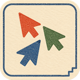

# Chord · 和弦

Chord helps people work on SiYuan documents together.

[中文](README.md)

## Features

- See who's online and which document they're reading.
- See other people's pointers and selected text.
- When someone is editing a block, others can't edit it.
- Undo only your own changes.

More collaboration features may come later. Ideas are welcome.

Oh, and if Chord helps you, feel free to buy me a beer 🍻!

Licensed under [MIT](LICENSE).
