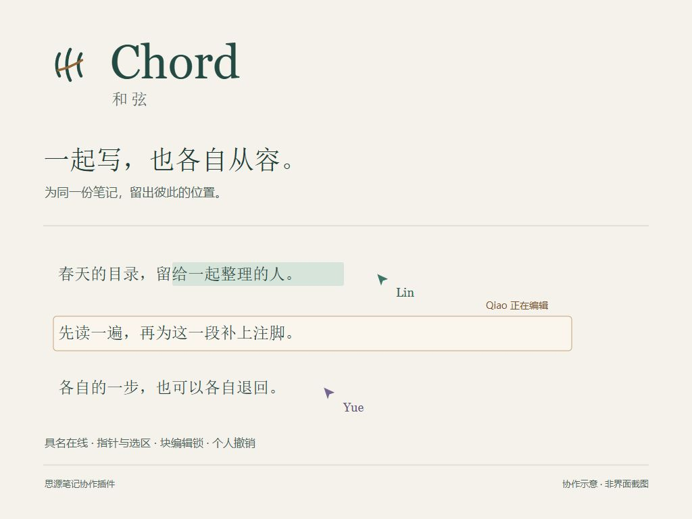

<p align="center"></p>

# 和弦 · Chord

**一起写，也各自从容。**

[English](README.en.md) · [使用手册](docs/guide.md) · [开发说明](docs/development.md) · [更新记录](CHANGELOG.md)

几个人打开同一份笔记，往往还需要问一句：你看到哪里了？这一段是谁在改？

我希望这些小事，可以由笔记自己交代。

和弦是一款思源笔记协作插件。它让正在阅读的人出现在文档树里，让指针和选中的文字带上各自的颜色，也在有人落笔时，为那一块内容留出明确的位置。你可以先读、先选、先复制，准备好了，再双击进入编辑。

取名“和弦”，是希望几个人的工作能够同时发生，也彼此听得见。



## 在同一页上，知道彼此在哪里

打开文档后，文档树会显示正在查看它的人。每个窗口初次加入时得到一个四位字母名，名字可以修改，颜色会随当前会话保留。

远端指针和文本选区跟随内容定位。即使窗口宽度不同、段落重新换行，或有人上下滚动，也会尽量落在对应的文字位置。它不会把你的页面一起拖走。

## 落笔之前，留一点余地

单击和框选用于阅读、复制，不申请编辑权。双击正文块后，和弦向内核申请这块内容的编辑权。块旁会出现光晕和正在编辑者的名字；同一块已有他人编辑时，仍可阅读和复制。

不同块可以分别编辑。写完后按 `Esc`，或单击另一块退出；最后的输入保存完成后，编辑锁才会主动释放。

## 改主意时，只退回自己的那一步

`Ctrl+Z` 撤销当前窗口、当前文档中自己的操作。`Ctrl+Y` 或 `Ctrl+Shift+Z` 重做。连续输入会适当合并，浏览状态下也能直接使用。

撤销前，和弦会重新核对正文和所需块的编辑权。如果这块内容已被其他操作改动，它会停下来说明原因，并保留记录。别人的后续修改，应当被认真对待。

## 开始使用

目前是 **0.7.0 发布准备版**，适配基线为 **思源 3.8.9**。尚未宣告上架集市。

所有参与窗口需要连接**同一个思源内核**，并启用同一版本的和弦。可用于桌面客户端、桌面独立窗口和桌面浏览器；移动端与发布页不在当前支持范围内。

1. 将插件文件放入 `<工作空间>/data/plugins/siyuan-plugin-chord/`，确保该目录下直接存在 `plugin.json` 和 `kernel.js`。使用发布包时，将 `package.zip` 的内容解压到这里。
2. 在思源的插件管理中启用“和弦”。每个参与窗口都需要加载新版本；更新后禁用再启用，或重新打开前端。
3. 点击顶栏笑脸图标对应的和弦菜单，修改自己的名字；打开同一篇文档，便可互相看到指针与文字选区。
4. 双击正文块开始编辑，按 `Esc` 退出。

光标与选区默认每秒最多同步 **10 次**。可在“光标追踪设置”中调整为 1–30 tick/秒；这是同一内核下共享的配置，保存后对所有参与窗口生效。

从此前的 `siyuan-plugin-starter` 原型切换时，请先退出编辑并确认正文已保存，再禁用旧插件。两个包名会被思源视为不同插件，**请勿同时启用**。旧版名字、窗口状态和频率设置不会自动迁移，个人撤销记录也不会导入。完整步骤见[使用手册](docs/guide.md)。

## 使用之前，先说清楚几件事

和弦把协作状态交给内核维护，正文仍由思源保存。它没有另起一套文档同步服务，也没有实现多人同时修改同一块的冲突合并。

- **编辑锁是参与前端共同遵守的约定。** 未启用插件的窗口、直接 API/MCP 写入和部分原生命令可能绕过它。内核裁定锁的归属，不代表内核会拒绝所有无锁写入。
- **在线数统计窗口会话，不是账号人数。** 同一窗口刷新会尽量复用身份；同一个人打开两个窗口，仍算两名参与者。显示名没有身份认证含义。
- **个人历史只在当前窗口内存中。** 刷新、关闭或禁用插件会清空。普通文字、格式及常规块插入、删除、拆分可撤销；数据库、块移动等复杂操作暂不支持，遇到会停住提示，不回退到共享撤销。
- **选区同步展示的是文字范围。** 它不替别人执行点击、复制或拖拽，也不覆盖块级框选、图片及数据库单元格选择。需要浏览器支持 CSS Custom Highlight。
- **定位有它的边界。** 未加载、折叠或不可见的目标会隐藏；图片、复杂表格等位置使用块内比例，无法承诺字符级精度。

这些约束也收录在[使用手册](docs/guide.md)和[开发说明](docs/development.md)。如果正在维护重要笔记，请先在测试文档中熟悉和弦，并沿用自己的备份习惯。

## 给准备读代码的人

这是一个原生 JavaScript 项目，没有运行时第三方依赖，也不需要编译前端代码。`kernel.js` 维护协作状态，`index.js` 负责窗口内的交互与显示。个人历史保留在各自窗口中。

```sh
npm test
npm run check
```

在 Windows 上执行 `npm run build`，可生成 `dist/package.zip`。构建工具、浏览器回归与发布前核对方式见[开发说明](docs/development.md)和[发布说明](docs/releasing.md)。

愿意一起改进的话，可以从[贡献说明](CONTRIBUTING.md)开始。我更在意一个问题能否被清楚复现、一处修改能否被耐心解释，而不是一份提案有多宏大。

## 许可与致谢

和弦以 [MIT License](LICENSE) 提供。项目起步于思源官方插件示例，保留其版权声明；来源与本项目资料的说明见 [NOTICE](NOTICE.md)。
