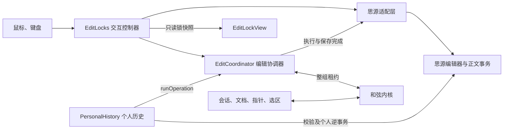
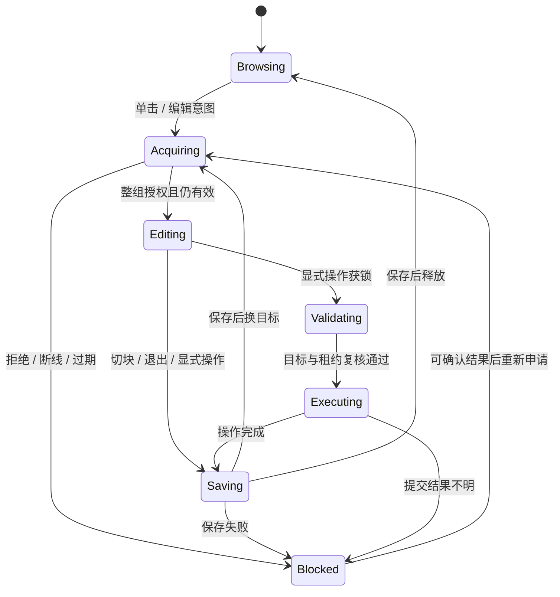
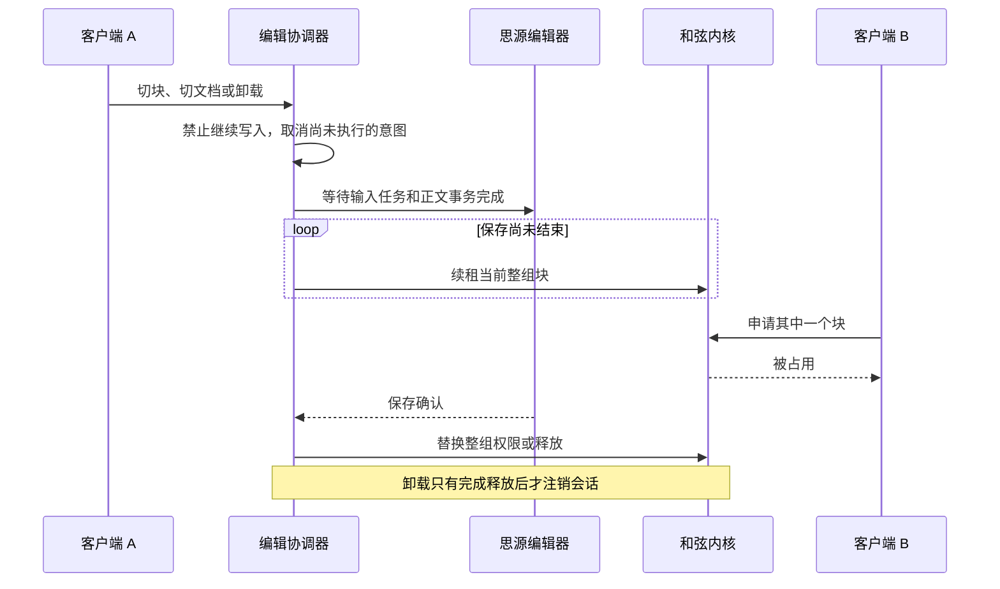
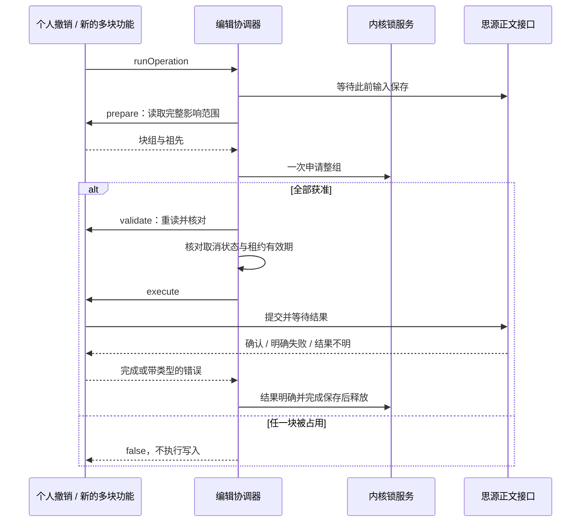

# 架构与编辑流程

和弦有两条工作线：共享“谁在哪里、选中了什么”，以及协调“谁能修改哪些块”。观看状态不能决定编辑锁的生死。

## 职责



`EditLocks` 保留原来的入口名称，继承 `EditCoordinator`。鼠标键盘和选区判断在控制器里；申请、续租、保存、释放和显式操作的顺序由协调器负责。个人历史不再直接申请或释放租约。

适配层收集真实影响块，区分 `selection` 与 `mutation`。例如双击选区停在下一块的起点时，浏览不申请边界块；实际跨块删除仍必须包含它。

## 编辑状态



`phase` 表示流程阶段，`lease` 保存内核已确认的整组权限，`held` 只表示当前允许交给原生编辑器使用的权限。等待换锁、保存或显式操作时，旧租约可以继续保留，但本地 `held` 会立即清空。

同一窗口的申请、释放和显式操作经过同一个队列。新的点击会使过期意图失效；已经发出的请求等待结果后再处理下一项。迟到应答不会重新激活已取消的编辑。内核重连也会使旧一代请求失效。

续租不排在保存后面，否则保存延迟时租约会失效。独立续租定时器会持续到退出流程结束；续租与换锁 RPC 不并发发送。合法的租约请求也刷新会话活跃时间，卸载期间即使停止了在线心跳，长时间保存也不会因此被会话清理。

## 保存与退出



保存失败保留原锁和待保存编辑器引用，重试保存成功前不能换组。多个编辑器同时保存时，要等所有请求结束，不能因为第一个失败就开始重试。即使编辑器已经从 `getAllEditor()` 消失，仍会尝试完成此前持锁编辑器的保存。

异常离线、进程被杀和浏览器关闭不保证异步卸载能够完成，最终仍依赖租约超时。租约超时不等于旧正文写入已经结束，不能把这套机制描述为服务端强互斥。

## 输入完成信号

普通文字和回车、退格等待授权时会缓冲。执行回车后，适配层等待思源 `flushPendingTransactions()` 完成，再获取新的选区和块组。已经获锁的原生结构按键也使用同样的完成屏障。

当前适配依赖该方法能够等待思源输入任务和事务队列。没有这个接口时不执行缓冲重放；更换思源版本后必须验证其行为，不能改成 `setTimeout` 代替。

等待授权时的内容比较忽略 `updated` 和临时 `wbr`，仍检查正文与格式。目标或选区失效会取消并提示用户重新输入，不会把文字写到另一个位置。尚未实现跨任意编辑器重绘的稳定草稿恢复；输入法组合也不做延迟重放。

## 多块操作入口

个人撤销已经通过 `runOperation` 执行。后续批量修改、删除或移动也从这里进入，不再调用底层 `editClaim`。

```js
await editing.runOperation({
    documentId,
    current: () => isIntentCurrent(),
    prepare: async () => readAffectedBlocks(),
    validate: async context => verifyContentAndLocations(context),
    execute: async context => submitAndWait(context),
});
```

这是接口示意，具体业务仍需实现回调。约定如下：

1. `prepare` 返回完整的 `{ documentId, blocks }`，包括源块、目标位置、必要祖先与相邻锚点。同一次只处理一篇文档，最多 200 个块；跨文档移动尚未开放。
2. 内核一次授予整组，或者全部拒绝。拒绝时保留此前已持有的组，不会出现拿到几个块就开始写的情况。
3. `validate` 在获锁后重新核对目标。正文、父子或相邻位置改变时直接抛错，不写入、不消耗个人历史。
4. `execute` 只有一个写入入口。尽可能把整组变更交给同一个思源事务，并等待完成；不能循环提交后把它称为原子操作。需要支持个人撤销的新功能，要同步记录它的正逆操作。
5. 回调内不能调用并等待 `claim`、`release` 或另一个 `runOperation`，否则会等待自己所在的队列。退出与取消从外部提交。
6. 执行前取消就不执行；提交开始后，退出必须等待提交结果，不能假装已经取消写入。
7. 返回 `true` 表示执行回调完成。若只是释放失败，仍返回 `true` 并单独提示，调用方不得重复执行。返回 `false` 表示写入回调没有运行；抛错后必须区分明确失败与结果不明。
8. 请求已发出但无法确认是否提交时，异常设置 `commitUnknown = true`。协调器停止后续编辑和重试，也不主动放锁；用户核对正文后刷新恢复。这个标记不能用于掩盖普通的校验失败。

保存屏障由 `claim` 和 `runOperation` 的入口负责，底层 `acquire` 只申请权限，避免同一次撤销在准备前后重复保存。操作执行后、放锁前仍要确认保存。个人历史的独立读取并发执行，每批最多 8 个块；有读取失败也要等同批请求结束，才能退出和释放锁。连续删除的相邻块按逆操作里的插入锚点追溯到存活块，循环或缺失的锚点仍拒绝恢复。

正文事务完成不代表 SQL 索引已经更新。个人撤销在 `prepare` 首次查询及获锁后的 `validate` 查询前，都等待 `/api/sqlite/flushTransaction` 确认；索引失败则保留记录并拒绝写入。这样既不会把自己刚删的块误判为仍然存在，也能识别获锁前已提交、但尚未进入索引的他人移动。



## 能保证的范围

块拖拽的同文档纵向移动由适配层读取源块、落点和原位置，交给同一个 `runOperation` 整组提交。纯 `move` 历史只验证存在性和位置，逆操作不携带旧正文，因此允许保留移动后的正文修改。混合快照转换仍拒绝重放。跨文档、横向新建容器、折叠块和需要清空/转换容器的落点在写入前明确拒绝；原地放下不创建记录。

原生拖拽结束会短暂清空选区。此时个人撤销关联到正在移动的编辑器；普通文字暂存到移动结束并重新获锁后执行。点击别处、失焦或失败会取消等待输入，提交已经开始则等待确认。补发文字前，适配层补齐原生编辑器被 `renderLocal` 清空的 `lastHTMLs` 快照，保证首字也能单独撤销。刷新仍会清空个人历史。

这套架构统一了启用和弦的窗口内的操作顺序。内核锁是协作租约，正文事务入口尚未原子检查租约代次和内容版本。外部 API、未启用插件的窗口和未覆盖的原生命令仍可能绕过。

强互斥需要思源正文事务执行点配合，不能用插件先读后写替代。后续若扩展跨文档、多事务或特殊编辑器，应先确认底层事务能力，再扩展这里的协议和回归。
